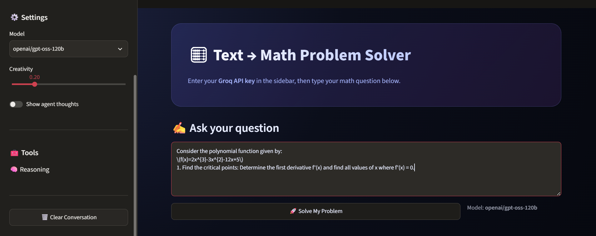
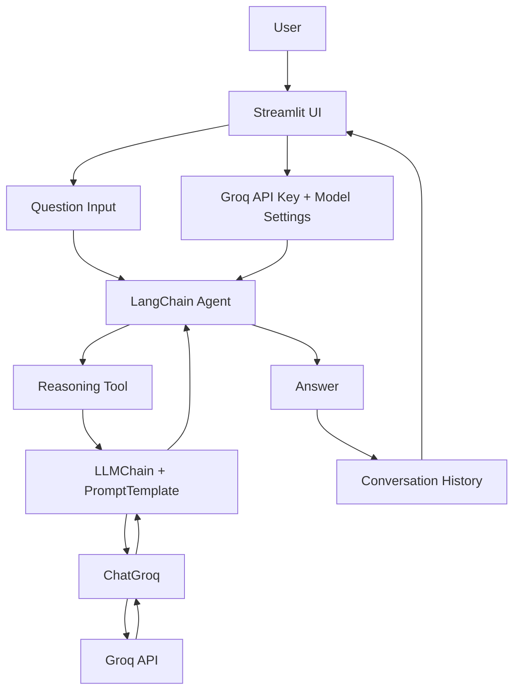

# 🧮 MathMind AI — Text-to-Math Problem Solver

An AI-powered math and reasoning assistant built with **Streamlit, LangChain, and Groq**. MathMind AI lets you submit math, logic, and data-related questions through a simple web interface and receive a step-by-step explanation from a Groq-hosted language model.

The application is branded as **MathMind AI** and provides a configurable model, creativity setting, conversation history, and optional agent activity display.




---

## ✨ Features

- **Natural-language problem solving** — ask math, logic, and reasoning questions in plain English.
- **Step-by-step explanations** — the prompt instructs the model to explain its reasoning and present a clear final answer.
- **Groq-powered inference** — connect with your own Groq API key.
- **Model selection** — choose between:
  - `openai/gpt-oss-120b`
  - `openai/gpt-oss-20b`
- **Creativity control** — adjust the model temperature from 0.0 to 1.0.
- **Agent activity view** — optionally show agent thoughts and tool activity.
- **Conversation history** — view questions and answers during the current Streamlit session.
- **Clear conversation** — reset the current chat from the sidebar.
- **Responsive Streamlit layout** — a wide interface with a custom dark gradient theme.

## 🛠️ Tech Stack

| Technology | Purpose |
|---|---|
| Python | Application logic |
| Streamlit | Web interface and session state |
| LangChain | LLM chain and agent orchestration |
| langchain-groq | Groq chat-model integration |
| Groq API | Hosted language-model inference |

## 🧠 How It Works

1. Launch the Streamlit application.
2. Enter a Groq API key in the sidebar.
3. Select a supported model and adjust the creativity setting.
4. Enter a math, logic, or reasoning question.
5. Select **Solve My Problem**.
6. The application creates or reuses a cached LangChain agent and sends the question to the model through a reasoning tool.
7. The response is displayed in the conversation and stored in Streamlit session state.

### Architecture



The current agent is configured with one tool, **Reasoning tool**, which invokes an LLM chain using a math-and-logic tutor prompt. The agent has a maximum of three iterations and enables parsing-error handling.

## 📁 Project Structure

```text
MathGPT/
├── app.py              # Main Streamlit MathMind AI application
├── test.py             # Small Streamlit sidebar/API-key input test
├── requirements.txt    # Python dependencies
├── images/
│   └── image.png       # Project image asset
├── .gitignore
└── README.md
```

## 🚀 Getting Started

### 1. Clone the repository

```bash
git clone https://github.com/Tauhid-Topu-007/MathGPT.git
cd MathGPT
```

### 2. Create a virtual environment

**Windows (PowerShell):**

```powershell
python -m venv .venv
.\.venv\Scripts\Activate.ps1
```

If PowerShell blocks script activation, use Command Prompt instead:

```cmd
.venv\Scripts\activate.bat
```

**Linux / macOS:**

```bash
python3 -m venv .venv
source .venv/bin/activate
```

### 3. Install dependencies

```bash
python -m pip install --upgrade pip
pip install -r requirements.txt
```

> **Note:** The requirements file includes several additional data, document, retrieval, and AI packages. The current `app.py` primarily uses Streamlit, LangChain, and the Groq integration.

### 4. Get a Groq API key

1. Visit the [Groq Console](https://console.groq.com/keys).
2. Sign in or create an account.
3. Generate an API key.
4. Keep the key private.

### 5. Run the application

```bash
streamlit run app.py
```

Streamlit will print a local URL in the terminal, usually:

```text
http://localhost:8501
```

Open that address in your browser.

### 6. Ask a question

- Paste your Groq API key into the password field in the sidebar.
- Choose a model.
- Enter your question in the main text area.
- Click **🚀 Solve My Problem**.

A sample word problem is preloaded in the question box so you can try the interface immediately.

## ⚙️ Configuration

| Setting | Available values | Description |
|---|---|---|
| Groq API Key | Your personal API key | Authenticates requests to Groq |
| Model | `openai/gpt-oss-120b`, `openai/gpt-oss-20b` | Selects the language model |
| Creativity | 0.0–1.0 | Controls the model temperature |
| Show agent thoughts | On / Off | Controls verbose agent activity |

The API key is entered at runtime through a password-type Streamlit input. Do not commit API keys, tokens, or other credentials to the repository.

## 🧪 Run the UI Test

The repository also contains a minimal Streamlit test page for checking the sidebar input:

```bash
streamlit run test.py
```

This is a small interface test; it does not run the MathMind reasoning agent.

## 📦 Main Dependencies

The application imports these core packages:

- `streamlit`
- `langchain`
- `langchain-groq`

The complete dependency list is maintained in [requirements.txt](requirements.txt).

## ⚠️ Current Scope and Limitations

- The current application uses a language model as its reasoning engine; it does not execute calculations with a dedicated symbolic mathematics engine.
- The configured agent currently has one reasoning tool. It does not yet include a calculator, Python execution, equation solver, graph plotter, or web-search tool.
- Model-generated answers can contain mistakes. Verify important calculations and use the solution as learning assistance rather than as a guaranteed mathematical proof.
- Conversation history is stored in Streamlit session state and is not implemented as persistent database storage.
- The app requires a working internet connection and a valid Groq API key to generate answers.

## 🗺️ Possible Future Improvements

- Add a deterministic calculator tool for arithmetic and numerical verification.
- Integrate SymPy for algebra, calculus, equations, and symbolic simplification.
- Add step-by-step equation rendering with LaTeX.
- Support image upload and OCR for handwritten or printed math problems.
- Add graph plotting for functions and statistical problems.
- Add subject modes for algebra, geometry, calculus, probability, and statistics.
- Add persistent user accounts and saved solution history.
- Add automated tests and a dedicated evaluation set for answer accuracy.

## 🔐 Security

- Never publish your Groq API key in source code, screenshots, commits, or issue reports.
- Use a private environment or secrets manager for production deployments.
- Rotate the key immediately if it is accidentally exposed.
- Apply appropriate usage limits and monitor API usage from your Groq account.

## 👨‍💻 Author

**Tauhidul Islam Topu**

- GitHub: [@Tauhid-Topu-007](https://github.com/Tauhid-Topu-007)
- LinkedIn: [Tauhidul Islam Topu](https://www.linkedin.com/in/tauhidul-islam-topu-1a04b31ab/)
- Portfolio: [Tauhidul Islam Topu](https://portfolio-frontend-rust-six.vercel.app/)

## 📄 License

No license file is currently included in this repository. Unless a license is added, the project remains subject to the default copyright rules; reuse, modification, and redistribution are not automatically granted.

---

<p align="center">
  Built with ❤️ using Python, Streamlit, LangChain, and Groq.
</p>
